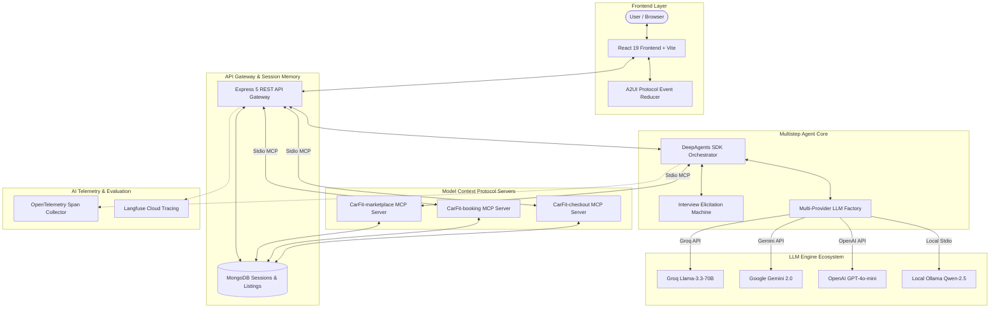

# CarFit AI — Multistep Agent for Buying and Renting Cars

[](https://github.com/google/a2ui)
[](https://modelcontextprotocol.io)
[](https://github.com/langchain-ai)
[](LICENSE)

**CarFit AI** is a full-stack, protocol-driven multistep AI agent designed for car purchasing and rentals. Instead of forcing users through rigid filters and static lists, CarFit AI interviews users conversationally inside a **Generative UI frontend**, queries car marketplace inventories through isolated **Model Context Protocol (MCP) servers**, transparently ranks matches using a **100-point multi-attribute utility model**, and executes embedded booking forms and safe mock payment checkouts directly inside the chat flow.

---

## 📸 Key Capabilities & Highlights

- **Conversational Slot Elicitation**: Interactively captures trip routes, vehicle categories, daily/purchase budgets (INR), target dates, seat capacity, and fuel types.
- **Generative UI via Google A2UI Protocol**: Emits streaming component layouts (`createSurface`, `updateComponents`, `updateDataModel`) — rendering live progress bars, vehicle recommendation catalogs, form fields, and checkout cards without static HTML injection.
- **In-Chat MCP Apps**: Integrates form-filling and mock payment interfaces as **MCP Apps** over Stdio transports (`CarFit-booking` and `CarFit-checkout`), letting users complete bookings inside the chat.
- **Multi-Attribute Intelligent Ranking**: Scores candidate cars using a weighted 100-point formula and provides human-readable bulleted reasoning for why each car fits.
- **Multi-Provider LLM Engine**: Supports zero-config model switching across **Free Groq Cloud API** (`llama-3.3-70b`), **Google Gemini API**, **OpenAI API**, local **Ollama** (`qwen2.5:7b`), and a deterministic state machine fallback.
- **AI Observability**: Instrumented with **OpenTelemetry** and **Langfuse SDK** to trace agent turns, prompt tokens, execution latency, and MCP tool invocations.
- **1-Command Containerization**: Fully containerized using multi-stage Docker builds, Nginx Alpine, and `docker-compose.yml`.

---

## 🏗️ Architecture & Component Flow



---

## 🔗 How the AI Agent Connects to LangChain, A2UI, and MCP Apps

### 1. User Interaction & Elicitation Turn
1. The user sends a chat message (e.g. *"I want to rent an SUV in Delhi under ₹2000/day for 5 people"*).
2. The Express API Gateway ([session.routes.js](file:///d:/car-marketplace/backend/src/api/session.routes.js)) loads the user's session state from MongoDB ([Session.js](file:///d:/car-marketplace/backend/src/models/Session.js)) and delegates to `runCarAgentTurn` in [car-agent.js](file:///d:/car-marketplace/backend/src/agent/car-agent.js).

### 2. Multi-Provider LLM Factory & LangChain Integration
1. The agent calls `getAgentModel()` in [car-agent.js](file:///d:/car-marketplace/backend/src/agent/car-agent.js), which checks `.env` for active LLM credentials:
   - **Groq API**: `ChatOpenAI({ apiKey, configuration: { baseURL: "https://api.groq.com/openai/v1" } })`
   - **Gemini API**: `ChatOpenAI({ apiKey, configuration: { baseURL: "https://generativelanguage.googleapis.com/v1beta/openai/" } })`
   - **OpenAI API**: `ChatOpenAI({ apiKey })`
   - **Ollama**: `ChatOllama({ baseUrl, model })`
2. It initializes a `createDeepAgent` harness from `deepagents` (built on top of `@langchain/langgraph`), injecting the MCP tool definition (`searchListingTool`).

### 3. MCP Tool Invocation over Stdio Transport
1. When all required slots are captured, the LangChain agent invokes the `search_listing` tool.
2. The tool handler in [car-agent.js](file:///d:/car-marketplace/backend/src/agent/car-agent.js) uses `@modelcontextprotocol/sdk` StdioClientTransport to call the isolated `CarFit-marketplace` MCP server ([marketplace-server.js](file:///d:/car-marketplace/backend/src/mcp/marketplace-server.js)).
3. The MCP server executes the database query ([search.js](file:///d:/car-marketplace/backend/src/marketplace/search.js)) and runs the 100-point multi-attribute ranking algorithm ([ranking.js](file:///d:/car-marketplace/backend/src/marketplace/ranking.js)), returning candidate vehicles with explainable reasoning bullets.

### 4. A2UI Generative Protocol Rendering
1. The backend ([builder.js](file:///d:/car-marketplace/backend/src/a2ui/builder.js)) serializes the agent's turn and recommendations into Google A2UI v0.9.1 protocol payload streams (`createSurface`, `updateDataModel`, `updateComponents`).
2. The React frontend renderer ([renderer.jsx](file:///d:/car-marketplace/frontend/src/a2ui/renderer.jsx)) parses the payload and maps component IDs to native React nodes ([catalog.jsx](file:///d:/car-marketplace/frontend/src/a2ui/catalog.jsx)), instantly displaying the interactive `CarCatalog`.

### 5. In-Chat Booking & Safe Mock Checkout MCP Apps
1. **Selection**: When the user clicks **Select** on a car, `/api/sessions/:sessionId/select` returns an `mcpApp` payload pointing to resource `ui://roam/booking-form.html`.
2. **Booking MCP Server**: The `CarFit-booking` server ([booking-server.js](file:///d:/car-marketplace/backend/src/mcp/booking-server.js)) streams the HTML booking form and handles submission via the `create_booking` MCP tool, creating a pending booking record.
3. **Checkout MCP Server**: Creation of the pending booking automatically launches the `CarFit-checkout` server ([checkout-server.js](file:///d:/car-marketplace/backend/src/mcp/checkout-server.js)). It streams `ui://roam/checkout-form.html` and executes the `mock_checkout` MCP tool, confirming the booking with a simulated reference code (`DEMO-XXXXXX`) — all inside the chat window without page redirects.

---

## 🛠️ Tech Stack & Dependencies

| Layer | Technologies & Libraries |
|---|---|
| **Frontend UI** | React 19, Vite 8, Tailwind CSS v4, Lucide React Icons |
| **Generative UI Protocol** | Google A2UI Protocol (v0.9.1 Schema Specification) |
| **Backend API Gateway** | Node.js 20 (ESM), Express 5, CORS, Helmet |
| **Database & Models** | MongoDB 7, Mongoose ORM, Zod Schema Validation |
| **Agent Core & LLM** | DeepAgents SDK, `@langchain/langgraph`, `@langchain/openai`, `@langchain/ollama` |
| **Tool Protocol** | `@modelcontextprotocol/sdk` (Stdio Transport) |
| **AI Observability** | OpenTelemetry API, Langfuse SDK v3 |
| **Containerization** | Docker, Nginx Alpine, Docker Compose |

---

## 📁 Repository Directory Structure

```
CarFit-AI/
├── docker-compose.yml              # Multi-container Docker compose configuration
├── spec.md                         # Full Technical Specification Document
├── README.md                       # Project documentation (this file)
├── .dockerignore                   # Excludes build contexts from Docker image
├── backend/
│   ├── Dockerfile                  # Backend Node.js 20 container definition
│   ├── package.json                # Backend dependencies & npm scripts
│   ├── .env.example                # Multi-provider environment configuration template
│   └── src/
│       ├── server.js               # Express API entrypoint & telemetry health routes
│       ├── agent/
│       │   ├── car-agent.js        # DeepAgents orchestrator & multi-provider LLM factory
│       │   └── interview.js        # Conversational slot elicitation state machine
│       ├── a2ui/
│       │   ├── builder.js          # Server-side A2UI event envelope builder
│       │   └── catalog.js          # Surface component catalog constants
│       ├── mcp/
│       │   ├── marketplace-server.js# Stdio MCP Server: search_listing tool
│       │   ├── booking-server.js   # Stdio MCP Server: create_booking tool & form resource
│       │   ├── checkout-server.js  # Stdio MCP Server: mock_checkout tool & payment resource
│       │   └── clients.js          # Stdio MCP Client manager with telemetry tracing
│       ├── marketplace/
│       │   ├── seed.js             # Marketplace dataset seeder (250 listings)
│       │   ├── search.js           # Database query engine
│       │   └── ranking.js          # 100-point multi-attribute ranking formula
│       ├── models/                 # Mongoose schema models (Listing, Session, Booking)
│       └── config/
│           ├── db.js               # MongoDB connection client
│           └── telemetry.js        # OpenTelemetry & Langfuse tracing instrumentation
└── frontend/
    ├── Dockerfile                  # Multi-stage Nginx Alpine container definition
    ├── nginx.conf                  # Nginx SPA fallback router & reverse proxy
    ├── package.json                # Frontend dependencies & npm scripts
    └── src/
        ├── App.jsx                 # React main shell & live chat panel
        ├── main.jsx                # React app mounting root
        └── a2ui/
            ├── renderer.jsx        # Client A2UI protocol reducer & component resolver
            ├── catalog.jsx         # React UI component catalog registry
            └── utils.js            # Path evaluation & INR currency formatters
```

---

## ⚡ Quickstart Guide

### Option 1: Run with Docker Compose (Recommended)

Run the entire application (MongoDB, Backend, and Frontend) in Docker:

```bash
docker compose up --build
```
- **Frontend App**: Open [http://localhost:3000](http://localhost:3000)
- **Backend API**: Running on [http://localhost:5000](http://localhost:5000)

---

### Option 2: Run Locally (Development Mode)

#### Prerequisites
- Node.js 20+
- MongoDB instance running locally on `mongodb://localhost:27017/car_market` (or MongoDB Atlas URI)

#### 1. Setup Backend
```bash
cd backend
npm install
cp .env.example .env
npm run seed      # Seeds 250 marketplace listings into MongoDB
npm run dev       # Starts backend server on http://localhost:5000
```

#### 2. Setup Frontend
```bash
cd frontend
npm install
npm run dev       # Starts Vite frontend on http://localhost:5173
```

---

## 🔑 Environment Variables Reference

Edit `backend/.env` to configure your preferred LLM provider:

```env
PORT=5000
MONGO_URI=mongodb://localhost:27017/car_market

# Option A: Free Groq Cloud API (Recommended — get free key at https://console.groq.com)
GROQ_API_KEY=gsk_...
GROQ_MODEL=llama-3.3-70b-versatile

# Option B: Free Google Gemini API (Get free key at https://aistudio.google.com)
# GEMINI_API_KEY=AIzaSy...
# GEMINI_MODEL=gemini-2.0-flash

# Option C: OpenAI API
# OPENAI_API_KEY=sk-...
# OPENAI_MODEL=gpt-4o-mini

# Option D: Local Ollama (Default fallback)
ENABLE_OLLAMA=true
OLLAMA_MODEL=qwen2.5:7b
OLLAMA_URL=http://localhost:11434

# Optional: AI Observability (Langfuse)
# LANGFUSE_PUBLIC_KEY=pk-lf-...
# LANGFUSE_SECRET_KEY=sk-lf-...
# LANGFUSE_HOST=https://cloud.langfuse.com
```

---

## 📜 License & Acknowledgments

- **License**: MIT License.
- **Protocols**: Built using [Google A2UI Protocol](https://github.com/google/a2ui) and [Model Context Protocol (MCP)](https://modelcontextprotocol.io).
- **Harness**: Powered by [DeepAgents](https://github.com/langchain-ai) and [LangChain](https://js.langchain.com).
