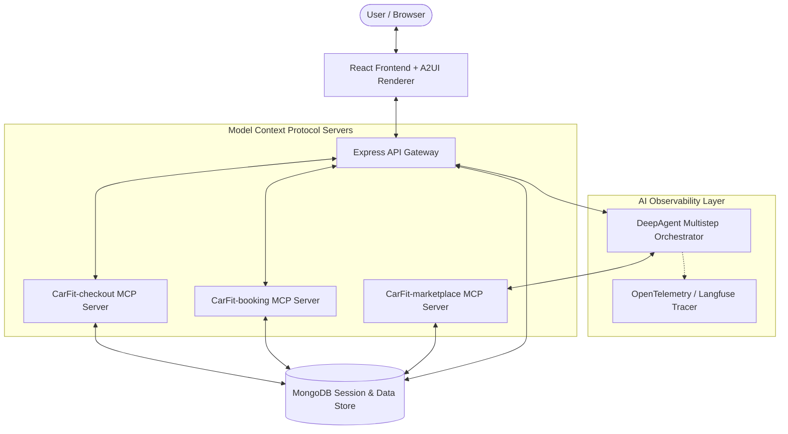

# CarFit AI — Technical Specification

> **Spec Version**: 1.0.0  
> **Harness**: DeepAgents SDK / LangChain LangGraph  
> **UI Protocol**: Google A2UI (Agent-to-UI) Protocol v0.9.1  
> **Tool Protocol**: Model Context Protocol (MCP) over Stdio  

---

## 1. Executive Summary & Architecture Overview

**CarFit AI** is a multistep AI agent designed for buying and renting cars. The system guides users interactively through a preference elicitation interview inside a Generative UI interface, queries marketplace listings via protocol-isolated MCP servers, ranks listings using a transparent multi-attribute scoring model, and renders embedded booking and safe mock checkout interfaces directly inside the chat conversation.

### 1.1 High-Level Architecture Diagram



---

## 2. Dynamic UI Specification: Google A2UI Protocol

The frontend interface relies on **Google's Agent-to-UI (A2UI)** protocol (`v0.9.1`). The server streams json-based event objects to dynamically control UI components and data bindings.

### 2.1 Event Envelope Formats

All A2UI messages wrap around standard message types:

1. **`createSurface`**: Initializes an isolated component rendering surface.
   ```json
   {
     "version": "v0.9.1",
     "createSurface": {
       "surfaceId": "agent-surface",
       "catalogId": "roam-catalog-v1",
       "theme": { "primaryColor": "#db6f45" },
       "sendDataModel": true
     }
   }
   ```

2. **`updateDataModel`**: Updates reactive client state at a specified path.
   ```json
   {
     "version": "v0.9.1",
     "updateDataModel": {
       "surfaceId": "agent-surface",
       "path": "/",
       "value": { "phase": "interviewing", "progress": { "done": 4, "total": 7 } }
     }
   }
   ```

3. **`updateComponents`**: Pushes standard Component AST nodes with data paths and event handlers.
   ```json
   {
     "version": "v0.9.1",
     "updateComponents": {
       "surfaceId": "agent-surface",
       "components": [
         { "id": "root", "component": "Column", "children": ["header", "progress"] },
         { "id": "header", "component": "Text", "text": "Live interview progress", "variant": "eyebrow" },
         { "id": "progress", "component": "ProgressBar", "value": { "path": "/progress/done" }, "max": 7 }
       ]
     }
   }
   ```

### 2.2 A2UI Component Catalog Registry

| Component Name | Description | Key Props & Bindings |
|---|---|---|
| `Column` | Vertical flex container | `children: string[]` |
| `Row` | Horizontal flex container | `children: string[]` |
| `Text` | Styled text element | `text: string \| {path}`, `variant: eyebrow \| h2 \| body \| confirmation` |
| `Badge` | Tag indicator | `text: string`, `suffix: string` |
| `ProgressBar` | Dynamic progress indicator | `value: {path}`, `max: number`, `label: string` |
| `Spinner` | Loading indicator | `label: string` |
| `PreferenceGrid` | Grid of extracted slots | `items: {path}` |
| `CarCatalog` | Ranked car recommendation cards | `items: {path}`, `action: {event: {name: "select_car"}}` |
| `VehicleSummary` | Selected car detail banner | `props: { vehicle: {path} }` |
| `TripGrid` | Summary of route and rental dates | `props: { route: {path}, dates: {path} }` |
| `AmountRow` | Pricing summary row | `props: { label: {path}, amount: {path} }` |
| `TextField` | Interactive form input | `props: { name, label, type, required }` |
| `Button` | Action button | `props: { text, primary }`, `action: {event: {name}}` |

---

## 3. Protocol-Driven Tool Specification: Model Context Protocol (MCP)

Tool integration is strictly decoupled using MCP Servers over Stdio transport.

### 3.1 `roam-marketplace` MCP Server
- **Server Name**: `roam-marketplace`
- **Tool**: `search_listing`
  - **Schema**:
    ```json
    {
      "transactionType": "rent | buy",
      "location": "string",
      "category": "string",
      "maxBudget": "number",
      "startDate": "YYYY-MM-DD",
      "endDate": "YYYY-MM-DD (optional)",
      "passengers": "number"
    }
    ```
  - **Returns**: Ranked listings matching the search criteria.

### 3.2 `roam-booking` MCP App Server
- **Server Name**: `roam-booking`
- **Resource**: `ui://roam/booking-form.html` (serves in-chat HTML booking form app)
- **Tool**: `create_booking`
  - **Schema**:
    ```json
    {
      "listingId": "string",
      "customer": { "name": "string", "email": "string", "phone": "string" },
      "startDate": "YYYY-MM-DD",
      "endDate": "YYYY-MM-DD"
    }
    ```
  - **Returns**: Pending booking record with total calculated amount in INR.

### 3.3 `roam-checkout` MCP App Server
- **Server Name**: `roam-checkout`
- **Resource**: `ui://roam/checkout-form.html` (serves safe mock payment checkout interface)
- **Tool**: `mock_checkout`
  - **Schema**:
    ```json
    { "bookingId": "string", "paymentMethod": "demo" }
    ```
  - **Returns**: Confirmed booking response with mock confirmation number (`DEMO-XXXXXX`).

---

## 4. Multistep Agent Elicitation & Scoring Engine

### 4.0 Multi-Provider Model Architecture
The agent supports a flexible model factory with automatic fallback priority:
1. **Free Cloud API (Groq)**: `GROQ_API_KEY` (`llama-3.3-70b-versatile`)
2. **Free Cloud API (Google Gemini)**: `GEMINI_API_KEY` (`gemini-2.0-flash`)
3. **OpenAI API**: `OPENAI_API_KEY` (`gpt-4o-mini`)
4. **Local Ollama**: `ENABLE_OLLAMA=true` (`qwen2.5:7b`)
5. **Deterministic State Machine**: Automatic fallback if no LLM provider or Ollama server is reachable.

### 4.1 Required Elicitation Slots

The agent interactively captures the following 6 core slots before triggering research:

1. **`transactionType`**: `"rent"` or `"buy"`
2. **`location`**: Origin city or pickup location
3. **`category`**: Vehicle category (SUV, Sedan, Electric, Luxury, etc.)
4. **`maxBudget`**: Maximum daily rate (for rental) or maximum price (for purchase) in INR
5. **`startDate`**: Start date (`YYYY-MM-DD`)
6. **`passengers`**: Required seat capacity

### 4.2 Multi-Attribute Ranking Scoring Formula

Each candidate car listing is evaluated according to a 100-point multi-attribute utility function:

$$\text{Score} = \text{Math.round}\left( 100 \times \left[ 0.30 \cdot S_{\text{budget}} + 0.20 \cdot S_{\text{category}} + 0.10 \cdot S_{\text{fuel}} + 0.15 \cdot S_{\text{seats}} + 0.15 \cdot S_{\text{features}} + 0.10 \cdot S_{\text{rating}} \right] \right)$$

Where:
- $S_{\text{budget}} = \max\left(0, 1 - \frac{\text{price} - \text{budget}}{\max(\text{budget}, 1)}\right)$
- $S_{\text{category}} = 1.0$ (exact match) or $0.35$ (fallback)
- $S_{\text{fuel}} = 1.0$ (exact match) or $0.50$ (fallback)
- $S_{\text{seats}} = \min\left(1.0, \frac{\text{listing.seats}}{\text{requested.passengers}}\right)$
- $S_{\text{rating}} = \frac{\text{rating}}{5.0}$

---

## 5. AI Observability & Evaluations Specification

AI observability is instrumented via OpenTelemetry and Langfuse SDK integration ([telemetry.js](file:///d:/car-marketplace/backend/src/config/telemetry.js)).

### 5.1 Telemetry Traces & Spans

- **`agent.turn`**: Spans every user turn, tracking:
  - Input query string
  - Current captured slots
  - Missing field array
  - LLM reply generation & response latency
  - Extracted recommendations count
- **`mcp.<server>.<tool>`**: Spans every MCP tool invocation (`search_listing`, `create_booking`, `mock_checkout`), recording input arguments, execution duration, and structured tool outputs.

### 5.2 Environment Variables

```env
LANGFUSE_PUBLIC_KEY=pk-lf-...
LANGFUSE_SECRET_KEY=sk-lf-...
LANGFUSE_HOST=https://cloud.langfuse.com
```

---

## 6. Dataset & Containerization Specification

### 6.1 Marketplace Dataset Criteria
- **Total Listings**: 250 listings seeded via [seed.js](file:///d:/car-marketplace/backend/src/marketplace/seed.js).
- **Categories (10)**: SUV, Sedan, Hatchback, Luxury, Electric, Hybrid, Truck, Convertible, Minivan, Compact.
- **Brands (10 per category)**: Toyota, Honda, BMW, Ford, Kia, Hyundai, Tesla, Volvo, Audi, Mazda.

### 6.2 Docker Multi-Container Architecture
- **Service `mongodb`**: `mongo:7.0` container listening on port `27017`.
- **Service `backend`**: Node.js container executing `seed.js` on startup and serving port `5000`.
- **Service `frontend`**: Nginx Alpine container serving optimized React build assets on port `3000`.
